# Jobs screenshots

The mocked browser spec is `tests/e2e/jobs-tray.spec.ts`. Capture the actual UI with:

```powershell
$env:QQQ_E2E_SERVER='production'
$env:QQQ_JOBS_SCREENSHOTS='docs/screenshots/jobs-tray'
$env:QQQ_E2E_PORT='3117'
pnpm exec playwright test tests/e2e/jobs-tray.spec.ts --workers=1 --reporter=list
```

Captured 2026-10-14 from the production build (`QQQ_E2E_SERVER=production`), 1000 px tall:

| View | 390 light | 390 dark | 1440 light | 1440 dark |
| --- | --- | --- | --- | --- |
| Live job | 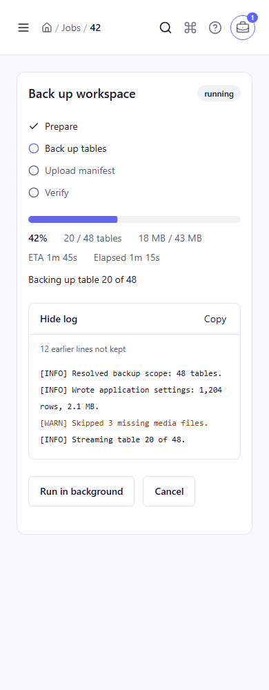 | 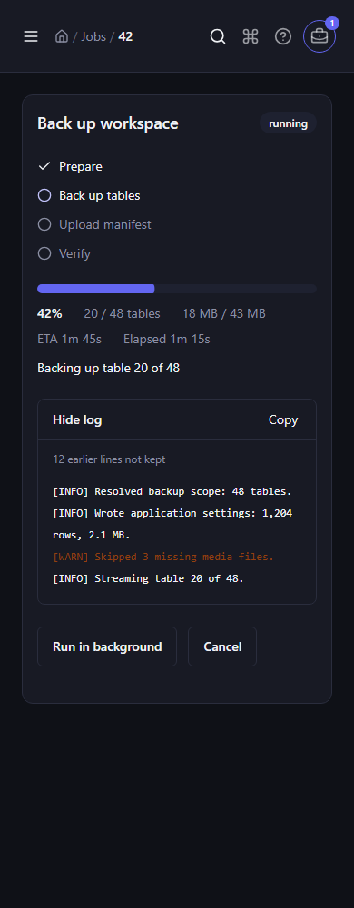 | 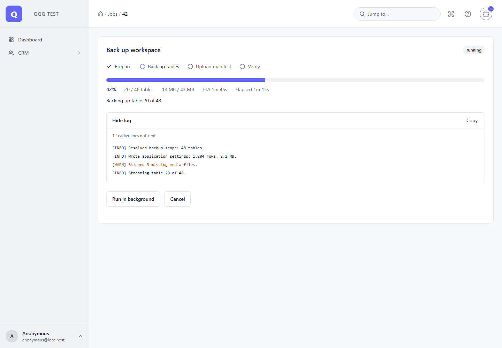 | 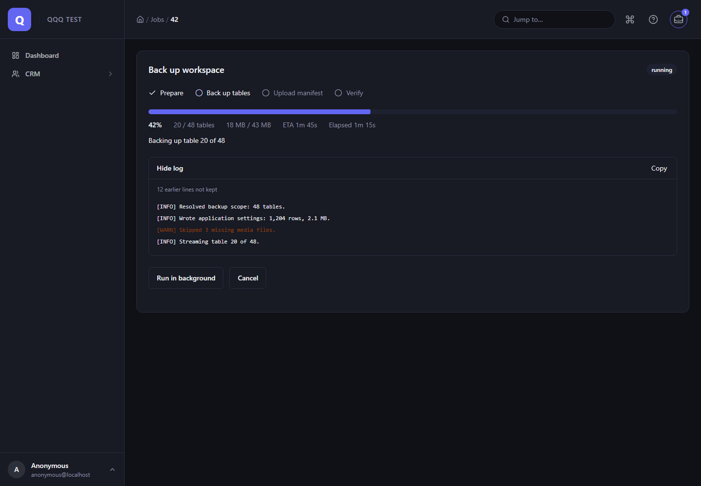 |
| Open tray | 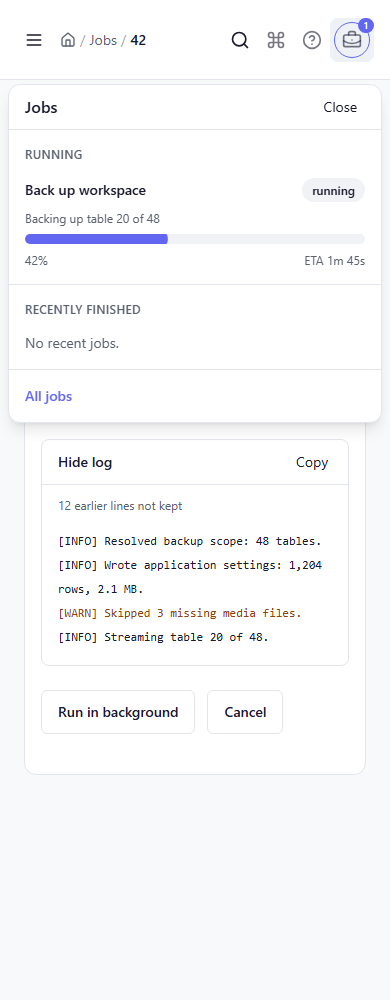 | 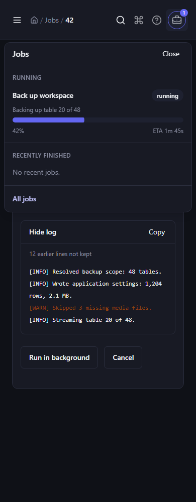 | 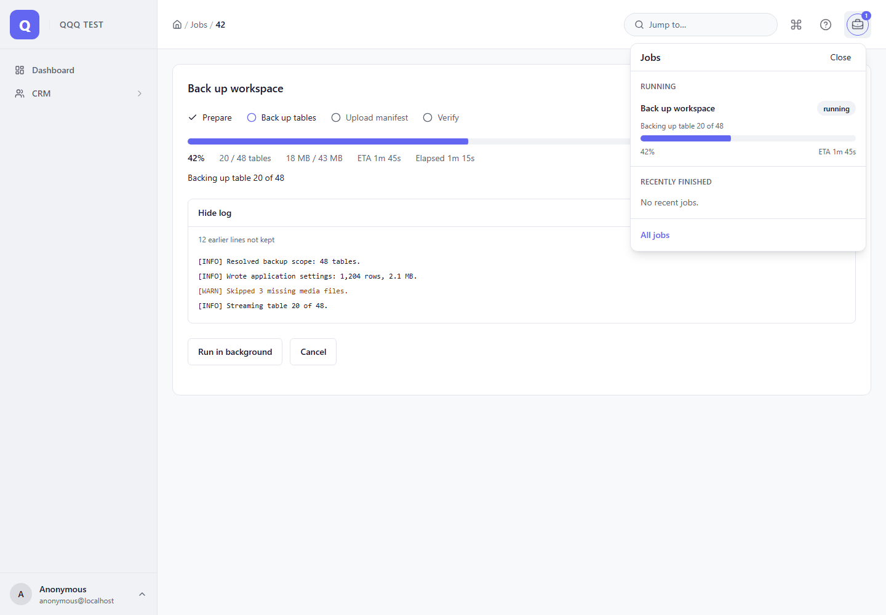 | 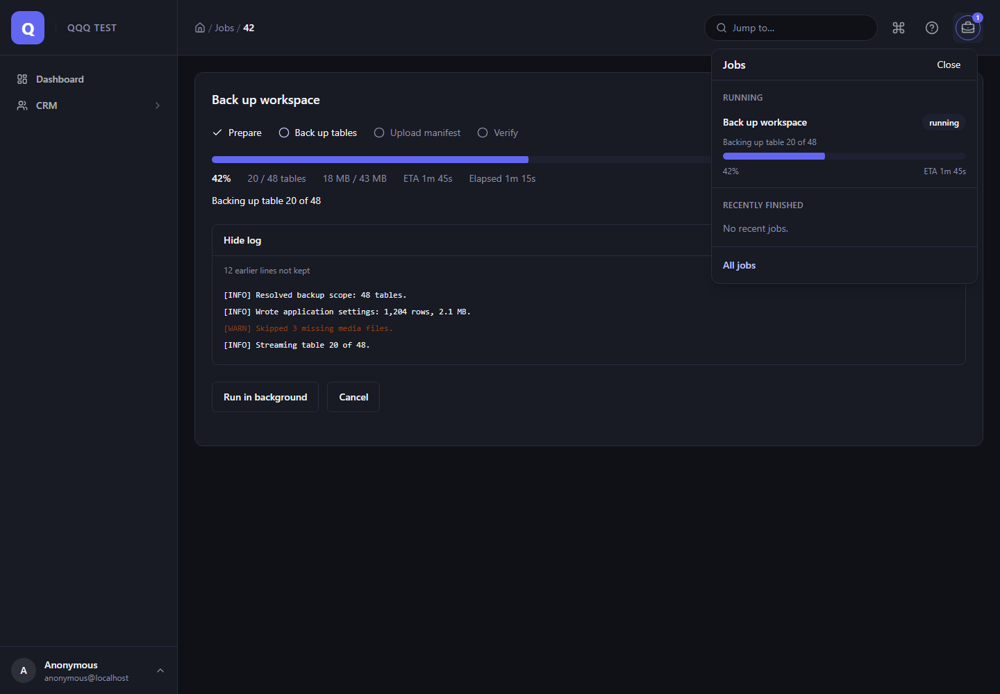 |
| Jobs page | 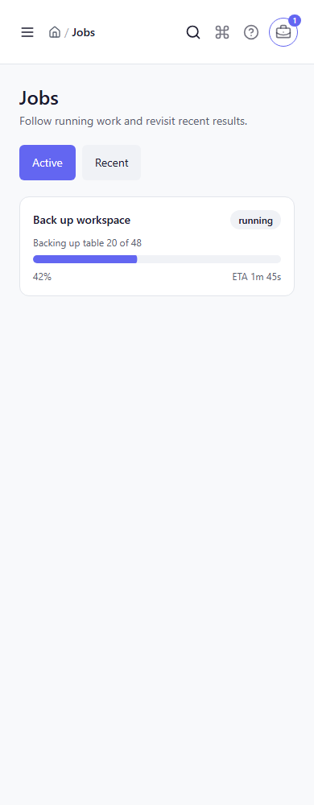 | 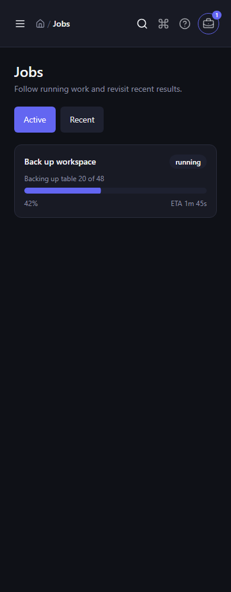 | 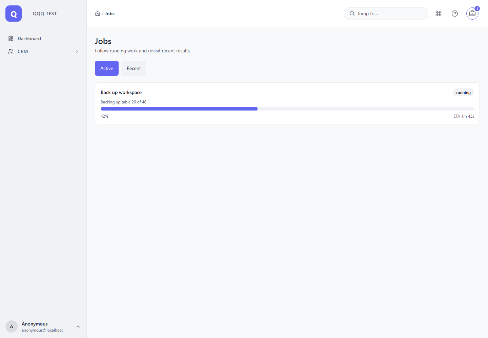 | 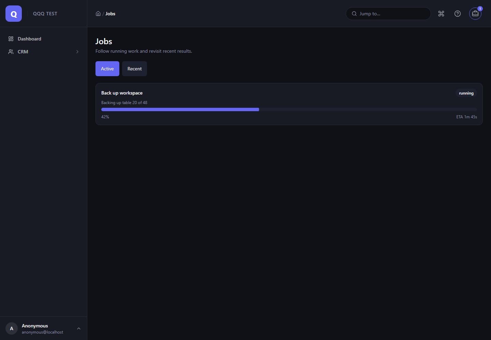 |

The spec also checks horizontal overflow, popover bounds, keyboard focus restoration, axe at 1440
light, and reduced motion; its lifecycle case runs an inline process, detaches it, watches it
finish in the tray and reopens the finished view.
